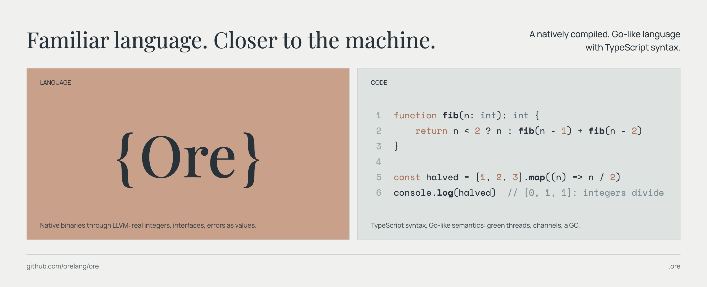

<p align="center">
  
</p>

<p align="center">
  <a href="#getting-started">Getting started</a> ·
  <a href="docs/spec">Specification</a> ·
  <a href="docs/architecture.md">Architecture</a> ·
  <a href="docs/roadmap.md">Roadmap</a> ·
  <a href="CHANGELOG.md">Changelog</a>
</p>

<p align="center">
  <a href="https://github.com/orelang/ore/releases/latest"></a>
  <a href="https://github.com/orelang/ore/actions/workflows/release.yml"></a>
  
  
  <a href="#license"></a>
</p>

```sh
curl -fsSL https://raw.githubusercontent.com/orelang/ore/main/install.sh | sh   # or: brew install orelang/tap/ore
```

**Ore** keeps the syntax of TypeScript and gives it native semantics: real
`i32`, `u64` and `f32` types, untyped numeric constants, explicit conversions,
nominal classes, structural interfaces, tagged unions with narrowing, errors
as values, generics by monomorphization, green threads with channels and a
garbage collector. Programs compile through LLVM to a single native binary.

```ts
import { Mutex } from "ore:sync"

function price(id: int): u64 | Error {
    task.sleep(10)
    return id > 0 ? u64(id) * 100 : new Error(`no item ${id}`)
}

const lock = new Mutex()
const done = new Chan<bool>()
let total: u64 = 0

for (const id of [3, -1, 7]) {
    task.spawn(() => {
        const p = price(id)
        if (p instanceof Error) console.error(p.message)
        else {
            using guard = lock.acquire()
            total += p
        }
        done.send(true)
    })
}
let finished = 0
while (finished < 3) {
    task.select([
        done.onReceive(() => finished++),
        task.after(1000, () => process.panic("too slow")),
    ])
}
console.log(`total: ${total}`)
```

```console
$ ore build prices.ore && ./prices
no item -1
total: 1000
```

## How it works

- **Compiler.** Ore's own parser reads TypeScript syntax into a tree with
  the node kinds of the TypeScript parser; the checker resolves names and types and lowers the program to a typed IR, with
  generics instantiated per type, closures with explicit captures, tagged
  unions and interface tables. Escape analysis keeps objects that never leave
  their function on the stack, and release builds inline small functions.
  The IR becomes LLVM IR, which clang compiles together with the runtime into
  one native binary.
- **Runtime.** Mostly written in Ore and compiled with the program, so it
  inlines into user code: strings, arrays, maps, number formatting, JSON, and
  the M:N scheduler of green threads (stackful, on a pool of OS threads,
  with the context switch in assembly), channels and `select`, and a
  netpoller on kqueue or epoll, printing, panics, files and sockets. Only
  libc is outside Ore, the garbage collector included: a mark-sweep
  collector in the shape of Go's, with per-thread allocation from
  size-classed spans.
- **Tooling.** One `ore` binary builds, runs, checks, tests and formats code
  and serves the language server. Debug builds keep stack traces for panics.
- **Platforms.** macOS and Linux, arm64 and x86-64.

The [specification](docs/spec) describes the language, the
[architecture](docs/architecture.md) the implementation, the
[roadmap](docs/roadmap.md) what comes next.

## The language at a glance

**Numbers are machine numbers.** `i8`…`i64`, `u8`…`u64`, `f32`, `f64`
(`int` is `i64`, `number` is `f64`). Literals adapt to their type;
types never mix without a conversion, integers wrap and divide as integers.

```ts
let n = 7      // int
let x = 7.0    // f64
console.log(n / 2, x / 2, f64(n) / 2)    // 3 3.5 3.5
n + x          // error: Operator '+' cannot be applied to types 'i64' and 'f64'. Convert one side explicitly
const b: u8 = 256                        // error: Constant 256 overflows 'u8' (range 0..255).
```

**Strings are UTF-8 bytes.** Immutable, with the JavaScript methods on byte
offsets; `for...of` walks runes.

```ts
const word = "héllo"
let runes = 0
for (const rune of word) runes++
console.log(word.length, runes, word.slice(0, 3), word.replaceAll("l", "L"))   // 6 5 hé héLLo
```

**Structural interfaces, nominal classes.** Any class or object with the
members fits an interface, fields included. A class may extend one class;
its methods are virtual.

```ts
interface Named {
    readonly name: string
}

class User {
    constructor(
        readonly name: string,
        private password: string,
    ) {}
}

const greet = (n: Named) => `hello, ${n.name}`
console.log(greet(new User("Ada", "secret")), greet({ name: "literal" }))   // hello, Ada hello, literal
```

**Unions narrow, and `switch` is exhaustive.** `T | null`, discriminated
unions, `typeof`, `instanceof`, `?.` and `??`.

```ts
type Shape = { kind: "circle"; r: f64 } | { kind: "rect"; w: f64; h: f64 }

function area(s: Shape): f64 {
    switch (s.kind) {
        case "circle":
            return Math.PI * s.r * s.r
        case "rect":
            return s.w * s.h
    }
}

const found = ["ada", "grace"].find((n) => n.startsWith("g"))   // string | null
console.log(area({ kind: "rect", w: 2, h: 3 }), found?.toUpperCase() ?? "nobody")   // 6 GRACE
```

**Errors are values.** No `throw`: a fallible function returns `T | Error`,
and the checker makes you look before you use the result.

```ts
function parseAge(text: string): int | Error {
    const n = Number.parseInt(text)
    if (n === null || n < 0) return new Error(`bad age '${text}'`)
    return n
}

const age = parseAge("forty")
if (age instanceof Error) console.log(age.message)   // bad age 'forty'
else console.log(age + 1)                            // age is an int here
parseAge("1") + 1   // error: Operator '+' cannot be applied to type 'Error | i64'.
```

**Generics are compiled per type,** with inferred type arguments and
`extends` constraints.

```ts
function last<T>(items: T[]): T | null {
    return items.length > 0 ? items[items.length - 1] : null
}

console.log(last([1, 2, 3]), last(["x", "y"]), last<f64>([]))   // 3 y null
```

**Closures, defaults, destructuring;** closures capture
variables by reference.

```ts
function counter(start = 0): () => int {
    let n = start
    return () => ++n
}

const next = counter(10)
next()
const { x, y } = { x: next(), y: 1 }
console.log(x, y, [3, 1, 2].map((v) => v * x).join(" "))   // 12 1 36 12 24
```

**Resources with `using`.** A value declared with `using` is disposed at the
end of its block, on every path out of it: return, `break`, `continue` or
the end of a loop iteration. Disposing calls its `[Symbol.dispose]()` method,
so files, locks and connections clean up after themselves. The syntax is the
`using` declaration of TC39's [Explicit Resource Management](https://github.com/tc39/proposal-explicit-resource-management)
proposal, as shipped in [TypeScript 5.2](https://www.typescriptlang.org/docs/handbook/release-notes/typescript-5-2.html#using-declarations-and-explicit-resource-management).

```ts
class Section {
    constructor(readonly name: string) {
        console.log("enter", name)
    }

    [Symbol.dispose](): void {
        console.log("leave", this.name)
    }
}

for (const name of ["a", "b"]) {
    using s = new Section(name)
    console.log("work in", s.name)
}   // enter a, work in a, leave a, enter b, work in b, leave b
```

**Typed JSON.** Code for each type is generated at compile time; a mismatch
is an `Error` that says where.

```ts
type Config = { name: string; port: int; tags: string[] }

const config = JSON.parse<Config>(`{"name": "api", "port": "80", "tags": []}`)
if (config instanceof Error) console.log(config.message)   // JSON: expected an integer, got a string at .port
console.log(JSON.stringify({ name: "api", port: 80, tags: ["v1"] }))   // {"name":"api","port":80,"tags":["v1"]}
```

**Regular expressions.** JavaScript's syntax and semantics, lookbehind and
the flags `d`, `u` and `v` included, with an engine written in Ore; a bad
literal is a compile-time error.

```ts
const date = /(?<year>\d{4})-(?<month>\d{2})/
const m = date.exec("released 2026-10")
if (m !== null) console.log(m.groups.get("year"), m.index)   // 2026 9
console.log("a-b_c".replace(/[-_]/g, " "), "x1y22z".split(/\d+/).join(","))   // a b c x,y,z
console.log("$42 or 17".match(/(?<=\$)\d+/)!.at(0), /\p{Script=Greek}+/u.exec("Ωμέγα")!.at(0))   // 42 Ωμέγα
```

**Green threads and channels.** Tasks run in parallel on all CPUs and talk
through channels and `select`; waiting parks the task, not the OS thread.
`ore:sync` adds `Mutex` and `WaitGroup`, `ore:net` TCP, `ore:crypto` SHA-256, `ore:path` paths.

```ts
const results = new Chan<int>()
for (let i = 1; i <= 3; i++) task.spawn(() => results.send(i * i))
let sum = 0
for (let i = 0; i < 3; i++) sum += results.receive() ?? 0   // 14

task.select([
    results.onReceive((v) => console.log("got", v)),
    task.after(100, () => console.log("timeout")),
])
```

**C, and the machine, when needed.** `declare function` calls C directly;
`unsafe` has raw memory, atomics and inline assembly, enough to write the
runtime itself in Ore ([unsafe code](docs/spec/09-unsafe.md)).

```ts
declare function strlen(s: string): u64
console.log(strlen("ore"))   // 3, from libc

const counter = unsafe.allocBytes(8)
unsafe.atomicAdd<i64>(counter, 5)
console.log(unsafe.atomicLoad<i64>(counter), unsafe.sizeOf<string>())   // 5 16
```

**Scripts, built-ins in namespaces.** A program is the top-level code of its
files, with no `main`. Built-ins live in namespaces: `console.log`,
`process.args`, `Math.sqrt`, `fs.readFile`; there are no bare globals.

What is left out on purpose: `any`, `undefined`, `var`, `==`, `throw`,
`enum`, `namespace`, `prototype`, `eval`, `delete`. See
[differences from TypeScript](docs/spec/10-differences.md).

## Getting started

On Linux (x86-64, arm64) and macOS (arm64):

```sh
curl -fsSL https://raw.githubusercontent.com/orelang/ore/main/install.sh | sh
```

or `brew install orelang/tap/ore`. A release carries its LLVM and lld; the
script installs what linking needs from the system, puts `ore` in
`~/.ore/bin` and adds it to the PATH. `ore update` updates it to the latest
release.

From source, the compiler (written in Ore) builds itself and checks that it
reproduces itself; it needs LLVM 19 or newer and lld (`apt install llvm-22-dev
lld-22`, `brew install llvm lld`), and starts from the previous release, or
from the seed (the last commit with the compiler in TypeScript, built once
with [Bun](https://bun.sh)):

```sh
ORE=~/.ore/bin/ore ci/bootstrap.sh dist   # dist/ore
```

Then:

```sh
ore init my-app          # package.json and src/main.ore
cd my-app
ore run                  # build and run
ore run --watch          # and again whenever a file of the program changes
ore build --release      # an optimized binary named after the package
ore check                # report errors without building
ore test                 # run the tests in *.test.ore files
ore test -t "math > add" # only the tests whose names match
ore fmt                  # format .ore files: 4 spaces, no semicolons
ore doc src/lib.ore      # the API of a module from its exports and JSDoc (--md, --json)
```

On a terminal, `ore` prints in color: error labels, the carets under an
error, the commands of `ore help`, the marks of `ore test`. `NO_COLOR=1`
turns colors off, `FORCE_COLOR=1` (or 2 for 256 colors, 3 for 24-bit) turns
them on even when the output is not a terminal; otherwise they follow
`COLORTERM` and `TERM`. Piped output has no colors.

A single file works too: `ore run hello.ore`. A debug build of a small
program takes about 0.3 s (LLVM through its C API on every CPU, linked with
lld), a release build about 1.4 s. LLVM's object files are kept in a build
cache (`~/.cache/ore`; `ore cache` prints its size, `ore cache clean`
empties it): another build compiles again only the source files that
changed, the runtime once per compiler, and a release build of an unchanged
program skips LLVM.

`dist/ore` is the compiler written in Ore ([compiler](compiler)); it
rebuilds itself with `ore build compiler/src/main.ore -o ore --release`.

## Projects and packages

An Ore project is an npm package. Its `package.json` names the entry module in
`main`, and dependencies are npm packages containing `.ore` files, installed
with npm (or bun, pnpm, yarn) into `node_modules` and locked in
`package-lock.json` as usual.

Modules import each other like TypeScript: `import { x } from "./util"`,
`import * as m from "./m"`, `import { y } from "some-package"`. Only exported
declarations are visible to other modules. Standard modules use the `ore:`
prefix:

```ts
import { test, expect } from "ore:test"
import { parseSize } from "./size"

test("parses sizes", () => {
    expect(parseSize("12", 1)).toBe(12)
})
```

Native code is declared in package.json, also by dependencies:

```json
{ "ore": { "link": ["sqlite3"], "sources": ["native/glue.c"] } }
```

## Editor support

Both extensions run `ore lsp` from `PATH`. The language server checks each
open document as you type: errors with their codes and a link to their page
in [`docs/errors`](docs/errors), hover with the signature and the JSDoc
comment, go to definition, completion after `.`, references and rename.

**Zed.** Run `zed: install dev extension` and select `editors/zed` (requires
Rust installed with rustup). Another binary can be set in Zed settings:

```json
{ "lsp": { "ore": { "binary": { "path": "/path/to/ore", "arguments": ["lsp"] } } } }
```

**VS Code.** Build the extension and install it:

```sh
cd editors/vscode
npm install
npm run package                      # ore-0.1.0.vsix
code --install-extension ore-0.1.0.vsix
```

Another binary can be set with the `ore.path` setting.

## Status

| Phase | |
|---|---|
| 1. Numbers, functions, control flow, first binary | done |
| 1.5. Language server and Zed extension | done |
| 2. Strings, arrays, garbage collector | done |
| 3. Object types, classes, interfaces | done |
| 4. Unions, narrowing, errors, generics, Map | done |
| 5. Closures, array methods, `using` | done |
| 6. Modules, packages, standard library, C interop, `ore test`, `ore fmt` | done |
| 7. Concurrency: tasks, `Chan<T>`, `select` on green threads | done |
| 7.5. Multi-threaded scheduler, blocking I/O handoff, `ore:sync` | done |
| 8. Performance: escape analysis, inlining, LLVM backend, low-level layer (`unsafe`, directives) | done |
| 8.5. Language completeness: destructuring, default and rest parameters, generic methods, getters and setters, `JSON` | done |
| 9. Runtime in Ore: no C left; only libc outside Ore | done |
| 10. Compiler in Ore: the whole toolchain (`ore` command, LLVM through its C API, tests), bootstrapped; no TypeScript left | done |
| 11. Own garbage collector: mark-sweep with parallel marking (done); precise heap, concurrent marking | in progress |
| 11.5. TypeScript gaps: tuples, spreads, `static`, overloads, optional properties, regular expressions, … ([roadmap](docs/roadmap.md)) | in progress |
| 12. Promises and `async`/`await` | planned |

### Known limitations

- Tasks are not preempted: a task that computes without waiting keeps its OS
  thread. Data races are not detected.
- A file operation occupies a whole OS thread while it runs (the network does
  not).
- A task has a fixed stack (256 KiB, 8 MiB for the top-level code); deep
  recursion in a task can overflow it.
- No numeric literal types (`1 | 2`); case mapping of strings covers ASCII
  only.
- A generic function or class that is never used is parsed but not checked.

## Development

```sh
ci/test.sh                       # every test, with dist/ore (see tests/README.md)
ORE_BLESS=1 ci/test.sh run/      # regenerate expected outputs of tests/run
tests/bench/run.sh               # time the benchmarks in tests/bench/ (release builds)
ci/test-linux.sh                 # the tests in Linux containers (arm64 and amd64), with Docker
ci/stress.sh                     # run the concurrent programs many times
```

The tests run on macOS and Linux, on arm64 and x86-64.

Every directory below has a README with the details.

| Path | Contents |
|---|---|
| `compiler` | The compiler, written in Ore (`dist/ore`): the `ore` command, parser, checker, IR, optimizer, LLVM backend through LLVM's C API, build driver, formatter, language server |
| `runtime/core` | The runtime written in Ore (`ore:runtime/...`), part of every program |
| `runtime/std` | Built-in declarations (`builtin.d.ore`) and standard modules (`ore:test`, `ore:sync`, `ore:net`, `ore:crypto`, `ore:path`) |
| `tests/run` | Programs with expected output, by topic; a directory with `main.ore` is one program |
| `tests/diag` | Programs with expected diagnostics (`// error: ...`), by topic |
| `tests/async` | Async tests with their expected output, waiting for async |
| `tests/bench` | Benchmarks |
| `tests/runner` | The test runner (`ci/test.sh`), written in Ore |
| `editors/zed` | Zed extension (GPL-3.0-or-later: it carries Zed's TypeScript queries) |
| `editors/vscode` | VS Code extension |
| `ci/` | Bootstrap, tests, stress tests, packaging and releases |

## License

Ore is licensed under either of the [MIT license](LICENSE-MIT) or the
[Apache License, Version 2.0](LICENSE-APACHE), at your option.

Contributions are accepted under the
[Contributor License Agreement](CLA.md), which assigns their copyright to the
Ore Team ([AUTHORS](AUTHORS)).

The Zed extension in [`editors/zed`](editors/zed) is the exception: it
carries Zed's TypeScript queries and is licensed under the
[GPL-3.0-or-later](editors/zed/LICENSE-GPL).
